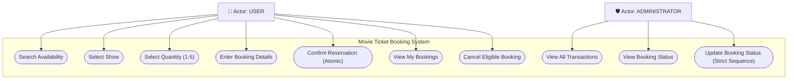
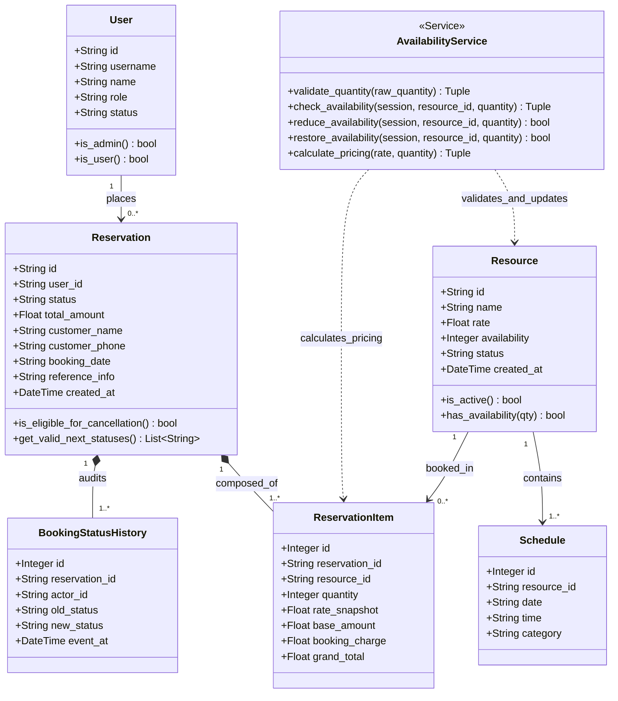

# Movie Ticket Booking System
**Software Engineering SAT-II Practical Assessment**

A robust, atomic, web-based Movie Ticket Booking System built with Python, Flask, SQLite, and SQLAlchemy ORM.

---

## 1. Project Title
**Movie Ticket Booking System**

---

## 2. Problem Statement
Movie ticket reservation platforms must handle concurrent requests, maintain strict seat inventory consistency, prevent overbooking, enforce exact business validation rules (such as seat limits, valid phone numbers, and tiered booking charges), snapshot historical rates, and adhere to deterministic lifecycle states. This project addresses these requirements by building a lightweight, transactional reservation system designed specifically for the Software Engineering SAT-II evaluation.

---

## 3. Objective
To construct a working, small-scale web reservation system that guarantees:
- Atomic reservations with strict seat capacity checking.
- Exact tier-based calculation of base amount, booking charges, and grand total.
- Separation of concerns across exactly two actors: `USER` and `ADMINISTRATOR`.
- Audit logging of all booking lifecycle transitions (`CONFIRMED` &rarr; `CHECKED_IN` &rarr; `COMPLETED`, or `CONFIRMED` &rarr; `CANCELLED`).
- Prevention of invalid status skips and duplicate seat restorations.
- Persistent SQLite storage surviving application restarts.

---

## 4. Features
- **Role Simulation Authentication:** Simple persona switcher between User 1, User 2, and Administrator (no production passwords or 3rd-party auth required).
- **Show Search & Live Availability:** Real-time visibility into active shows, schedules, seat categories, base rates, and live availability.
- **Dynamic Pricing Calculator:** Real-time calculations of base price, conditional booking charges, and grand totals.
- **Atomic Booking Transactions:** Atomic database transactions ensuring that seat reductions, snapshots, records, and history entries occur together or roll back completely.
- **Rate Snapshotting:** Preservation of the ticket rate at the moment of booking, safeguarding historical financial integrity against future price changes.
- **Strict Status Lifecycle Management:** State transition rules preventing administrators or users from skipping stages or resurrecting cancelled bookings.
- **Safe Self-Service Cancellation:** Automatic return of reserved seats to inventory exactly once upon user cancellation of confirmed bookings.

---

## 5. Actors & Permissions

| Actor | Permissions | Prohibitions |
| :--- | :--- | :--- |
| **USER** | Search active shows, select show & quantity (1–5), enter booking details, confirm reservation, view own bookings, cancel own eligible confirmed booking. | Cannot view or modify other users' bookings; cannot update administrative/operational lifecycle status. |
| **ADMINISTRATOR** | View all customer bookings and transactions, inspect full booking status and audit histories, advance status only to the next valid stage. | Cannot skip status stages (e.g., cannot jump from `CONFIRMED` directly to `COMPLETED`); cannot resurrect cancelled bookings. |

---

## 6. Technology Used
- **Backend Language:** Python 3.12+
- **Web Framework:** Flask 3.0+
- **ORM / Database Layer:** SQLAlchemy 2.0+
- **Database:** SQLite 3 (`database.db`)
- **Frontend:** HTML5, CSS3 (Modern dark-mode design system with responsive cards and clean typography), JavaScript (Vanilla ES6)
- **Automated Testing:** `pytest` 7.4+

---

## 7. Project Structure
```text
movie-ticket-booking/
│
├── app.py                      # Flask application factory and server entrypoint
├── database_setup.py           # SQLite engine, schema initialization & seed data script
├── database.db                 # SQLite persistent database file
├── requirements.txt            # Python dependencies (Flask, SQLAlchemy, pytest)
├── README.md                   # Comprehensive technical documentation & assessment evidence
│
├── models/                     # SQLAlchemy ORM Entities
│   ├── __init__.py             # Package exports
│   ├── base.py                 # Declarative Base
│   ├── user.py                 # User model (USER / ADMINISTRATOR)
│   ├── resource.py             # Resource model (Movie shows, rates, availability)
│   ├── reservation.py          # Reservation model (Customer info, totals, status)
│   ├── reservation_item.py     # ReservationItem model (Rate snapshots, quantities)
│   ├── schedule.py             # Schedule model (Date, time, category)
│   └── booking_status_history.py # BookingStatusHistory audit trail model
│
├── services/                   # Business Logic Layer
│   ├── __init__.py
│   └── availability_service.py # Seat capacity validation, fare & charge calculation
│
├── routes/                     # Blueprint Route Controllers
│   ├── __init__.py
│   ├── helpers.py              # Session authentication & DB context helpers
│   ├── user_routes.py          # User endpoints (Login, shows, booking, my-bookings, cancel)
│   └── admin_routes.py         # Administrator endpoints (Overview, status advancement)
│
├── templates/                  # HTML5 Templates
│   ├── base.html               # Master layout with navbar, flash messages & footer
│   ├── login.html              # Persona role selection screen
│   ├── dashboard.html          # User home dashboard
│   ├── shows.html              # Active show catalog & search
│   ├── booking.html            # Booking form with real-time fee breakdown
│   ├── booking_success.html    # Confirmation receipt & snapshot breakdown
│   ├── my_bookings.html        # User booking list with conditional cancel button
│   ├── booking_details.html    # Detailed booking breakdown & audit timeline
│   ├── admin_dashboard.html    # Admin transaction overview & status control
│   └── error.html              # Standardized validation error & status code display
│
├── static/
│   ├── css/
│   │   └── style.css           # Modern design system, badges, layout & animations
│   └── js/
│       └── script.js           # Real-time pricing calculator & client validation
│
└── tests/
    ├── __init__.py
    └── test_booking.py         # Complete automated test suite covering T1–T12
```

---

## 8. Database Design
The schema uses relational integrity via foreign keys:

1. **`users`**
   - `id` (VARCHAR PK): e.g. `'user1'`, `'user2'`, `'admin'`
   - `username` (VARCHAR UNIQUE)
   - `name` (VARCHAR)
   - `role` (VARCHAR): `'USER'` or `'ADMINISTRATOR'`
   - `status` (VARCHAR): `'ACTIVE'`
2. **`resources`**
   - `id` (VARCHAR PK): e.g. `'R101'`, `'R102'`, etc.
   - `name` (VARCHAR): Item name, e.g. `'Show Seat A'`
   - `rate` (FLOAT): Base ticket price
   - `availability` (INTEGER): Live remaining seats
   - `status` (VARCHAR): `'ACTIVE'` / `'INACTIVE'`
   - `created_at` (DATETIME)
3. **`schedules`**
   - `id` (INTEGER PK AUTOINCREMENT)
   - `resource_id` (VARCHAR FK &rarr; `resources.id`)
   - `date` (VARCHAR): e.g. `'2026-10-10'`
   - `time` (VARCHAR): e.g. `'06:30 PM'`
   - `category` (VARCHAR): e.g. `'Evening Show - Screen 1'`
4. **`reservations`**
   - `id` (VARCHAR PK): e.g. `'RES-20261008-0001'`
   - `user_id` (VARCHAR FK &rarr; `users.id`)
   - `status` (VARCHAR): `'CONFIRMED'`, `'CHECKED_IN'`, `'COMPLETED'`, `'CANCELLED'`
   - `total_amount` (FLOAT): Grand total
   - `customer_name` (VARCHAR)
   - `customer_phone` (VARCHAR): 10-digit number
   - `booking_date` (VARCHAR)
   - `reference_info` (VARCHAR)
   - `created_at` (DATETIME)
5. **`reservation_items`**
   - `id` (INTEGER PK AUTOINCREMENT)
   - `reservation_id` (VARCHAR FK &rarr; `reservations.id`)
   - `resource_id` (VARCHAR FK &rarr; `resources.id`)
   - `quantity` (INTEGER): 1 to 5
   - `rate_snapshot` (FLOAT): Rate captured at time of booking
   - `base_amount` (FLOAT): `rate_snapshot * quantity`
   - `booking_charge` (FLOAT): `50.0` or `0.0`
   - `grand_total` (FLOAT): `base_amount + booking_charge`
6. **`booking_status_histories`**
   - `id` (INTEGER PK AUTOINCREMENT)
   - `reservation_id` (VARCHAR FK &rarr; `reservations.id`)
   - `actor_id` (VARCHAR): User or admin ID
   - `old_status` (VARCHAR NULLABLE)
   - `new_status` (VARCHAR)
   - `event_at` (DATETIME)

---

## 9. Business Rules (BR1 - BR10)

- **BR1 - QUANTITY:** A user may reserve only 1 to 5 seats in one booking. Rejects 0, negatives, numbers above 5, decimal values (e.g. 1.5), and non-numerics. Accepts only integers: `1, 2, 3, 4, 5`.
- **BR2 - AVAILABILITY:** A show can only be reserved if active and available. Merely viewing/selecting a show does NOT reserve seats. Availability is re-checked during final confirmation. If capacity changed before confirmation, reject booking with zero DB changes.
- **BR3 - FARE:** Capture current rate at confirmation as an immutable snapshot (`rate_snapshot`). If show rate changes later, existing bookings retain their original rate.
- **BR4 - TOTAL:**
  $$\text{base\_total} = \text{rate} \times \text{quantity}$$
  $$\text{booking\_charge} = \begin{cases} \text{Rs. } 50, & \text{if } \text{base\_total} < 1000 \\ \text{Rs. } 0, & \text{if } \text{base\_total} \ge 1000 \end{cases}$$
  $$\text{grand\_total} = \text{base\_total} + \text{booking\_charge}$$
  Tested at boundary values: Rs. 999, Rs. 1000, and Rs. 1001.
- **BR5 - DETAILS:** Name cannot be blank. Phone must contain exactly 10 digits (`^\d{10}$`). Booking date must be valid format (`YYYY-MM-DD`). Reference ID must be provided.
- **BR6 - CONFIRMATION:** Any request with missing/invalid details, invalid quantity, or unavailable capacity is rejected. On failure, no reservation record is created, no availability is decremented, and no partial DB update occurs.
- **BR7 - SUCCESS:** A valid transaction creates exactly ONE `CONFIRMED` reservation, saves resource details, saves quantity, saves fare snapshot, saves grand total, decrements availability, and writes a status history entry. All steps execute inside a single atomic database transaction with automatic rollback on error.
- **BR8 - STATUS LIFECYCLE:**
  - Valid normal sequence: `CONFIRMED` &rarr; `CHECKED_IN` &rarr; `COMPLETED`
  - Valid cancellation sequence: `CONFIRMED` &rarr; `CANCELLED`
  - Prohibited: `CONFIRMED` &rarr; `COMPLETED` (skipping `CHECKED_IN`), `CONFIRMED` &rarr; `CANCELLED` &rarr; `COMPLETED`, `COMPLETED` &rarr; `CANCELLED`, `CANCELLED` &rarr; `CONFIRMED`.
- **BR9 - CANCELLATION:** Only a `CONFIRMED` booking can be cancelled by its owner. On cancellation: status becomes `CANCELLED`, availability is restored exactly ONCE, and status history is recorded. Repeated cancellation is rejected without duplicate seat restorations.
- **BR10 - ACCESS CONTROL:** Users can only view and cancel their own bookings. Users cannot view/modify other users' bookings or alter admin operational status. Only administrators can advance operational stages.

---

## 10. Functional Requirements (FR1 - FR10)

- **FR1:** Display and search active shows with ID, schedule, category, rate, and live availability.
- **FR2:** Allow selection of show and quantity conforming to BR1 and BR2.
- **FR3:** Dynamically calculate and display base amount, booking charge, and grand total.
- **FR4:** Validate user, details, quantity, and live availability prior to persistence.
- **FR5:** Atomically create unique `CONFIRMED` booking, store rate snapshot, reduce availability, and write status audit entry.
- **FR6:** Display logged-in user's own bookings and ticket details.
- **FR7:** Enable Administrator to view all bookings and advance status only to the next valid sequence.
- **FR8:** Allow eligible user cancellation and restore seat availability exactly once.
- **FR9:** Display clear error messages for invalid input, unavailable capacity, unauthorized access, invalid transitions, and duplicate cancellations.
- **FR10:** Persistently store users, resources, schedules, reservations, reservation items, and status history in SQLite.

---

## 11. Non-Functional Requirements
- **Data Integrity:** ACID-compliant atomic transactions with automatic rollback.
- **Portability:** Zero external service dependencies; operates completely standalone on Windows/macOS/Linux.
- **Auditability:** Complete timestamped record of every status change with actor attribution.
- **Usability:** Responsive dark-mode interface with clear error callouts and contextual feedback.

---

## 12. Setup & Installation Instructions

### Prerequisites
- Python 3.10+ installed and added to system PATH.
- Virtual environment (optional, but recommended).

### Commands
```bash
# 1. Open terminal inside project directory:
cd "c:\Users\yuges\OneDrive\Desktop\MOVIE booking system"

# 2. Install dependencies:
pip install -r requirements.txt

# 3. Initialize SQLite database & seed exact demonstration data:
python database_setup.py

# 4. Start the application:
python app.py
```

### Accessing the Application
Open your browser and navigate to:
```
http://127.0.0.1:5000
```

---

## 13. Demo Login Credentials & Roles
Use the persona selector on the login screen or quick-login buttons:

| Persona | Username | Role | Description |
| :--- | :--- | :--- | :--- |
| **User 1** | `user1` | `USER` | Alice &mdash; Regular customer |
| **User 2** | `user2` | `USER` | Bob &mdash; Independent customer (used for access boundary tests) |
| **Administrator** | `admin` | `ADMINISTRATOR` | System Administrator &mdash; Operational supervisor |

---

## 14. Mandated Demonstration Seed Data
*Preloaded exactly as specified by assessment instructions:*

| ID | Resource / Item | Rate | Initial Availability | Schedule / Category |
| :--- | :--- | :--- | :--- | :--- |
| **R101** | Show Seat A | Rs. 499 | **10** | 2026-10-10 &bull; 06:30 PM &bull; Evening Show - Screen 1 |
| **R102** | Show Seat B | Rs. 799 | **5** | 2026-10-10 &bull; 09:30 PM &bull; Night Show - Screen 2 |
| **R103** | Show Seat C | Rs. 199 | **20** | 2026-10-11 &bull; 02:00 PM &bull; Matinee Show - Screen 1 |
| **R104** | Show Seat D | Rs. 1,299 | **0** (Sold Out) | 2026-10-11 &bull; 06:00 PM &bull; Premium Evening - IMAX 3D |
| **R105** | Show Seat E | Rs. 1,000 | **3** | 2026-10-11 &bull; 09:00 PM &bull; Special Screening - Screen 3 |

---

## 15. Testing Documentation & Results (T1 - T12)

Execute all 12 test cases using pytest:
```bash
python -m pytest -v tests/test_booking.py
```

### Test Execution Results Table

| Test ID | Test Description | Precondition | Steps | Expected Result | Actual Result | Pass/Fail | Evidence / Log |
| :--- | :--- | :--- | :--- | :--- | :--- | :--- | :--- |
| **T1** | Select same resource twice | Show R101 active with 10 seats | User accesses `/booking/R101` twice consecutively | No reservation record created; availability stays 10 | 0 bookings created; availability remains 10 | **PASS** | `test_booking.py::test_t1_select_same_resource_twice PASSED` |
| **T2** | Quantity boundary validation (0, 1, 5, 6, 1.5) | Quantity validation service initialized | Validate inputs 0, 1, 5, 6, 1.5, "1.5", -1, "abc" | Only 1 and 5 and valid integers 1..5 accepted; others rejected | 1 and 5 accepted; 0, 6, 1.5, "abc" rejected with clear error | **PASS** | `test_booking.py::test_t2_quantity_validation PASSED` |
| **T3** | Try unavailable resource R104 | Show R104 has 0 seats available | POST booking request for 1 seat of R104 | Rejected with "This show is currently unavailable"; 0 bookings | Rejected with 400 error; DB unchanged; 0 seats remain | **PASS** | `test_booking.py::test_t3_unavailable_resource_r104 PASSED` |
| **T4** | Fee calculation boundaries (Rs. 999, 1000, 1001) | Pricing calculation rules BR4 | Compute charges for Rs. 999, Rs. 1000, and Rs. 1001 | 999 &rarr; Charge Rs. 50 (Total 1049); 1000 &rarr; Charge Rs. 0; 1001 &rarr; Charge Rs. 0 | Rs. 999+50=1049; Rs. 1000+0=1000; Rs. 1001+0=1001 | **PASS** | `test_booking.py::test_t4_booking_charge_boundaries PASSED` |
| **T5** | Complete one valid reservation | R101 has 10 seats; user1 logged in | POST booking for 2 seats with valid details | 1 CONFIRMED booking created; R101 availability becomes 8; rate snapshot saved; history added | Booking created; availability 8; snapshot Rs. 499; history CONFIRMED | **PASS** | `test_booking.py::test_t5_complete_valid_reservation PASSED` |
| **T6** | Confirm with invalid / missing details | User on booking screen | Submit form with blank name, 9-digit phone, or missing date | Rejected with clear message; 0 reservations created; availability unchanged | 400 rejection; error messages match BR5; capacity untouched | **PASS** | `test_booking.py::test_t6_confirm_with_invalid_details PASSED` |
| **T7** | Change availability before confirmation | R102 availability reduced to 1 by concurrent event | User attempts confirmation for 3 seats | Rejected with "Requested quantity is not available"; rollback | 400 rejection; 0 bookings created; availability remains 1 | **PASS** | `test_booking.py::test_t7_change_availability_before_confirmation PASSED` |
| **T8** | Unauthorized user access | User 1 owns booking `RES-001` | User 2 attempts to view details or cancel `RES-001` | 403 Forbidden; "You are not authorized to access this booking"; status unchanged | 403 HTTP status; access denied; status remains CONFIRMED | **PASS** | `test_booking.py::test_t8_unauthorized_user_access PASSED` |
| **T9** | Admin status progression and skip rejection | Booking in `CONFIRMED` status; Admin logged in | Admin tries: 1) CONFIRMED &rarr; COMPLETED; 2) CONFIRMED &rarr; CHECKED_IN; 3) CHECKED_IN &rarr; COMPLETED; 4) COMPLETED &rarr; CANCELLED | Step 1 rejected (400); Step 2 succeeds; Step 3 succeeds; Step 4 rejected (400) | Invalid transitions rejected; strict linear progression enforced | **PASS** | `test_booking.py::test_t9_admin_status_transitions_and_skipping PASSED` |
| **T10** | Cancellation and repeat cancellation prevention | Booking in `CONFIRMED` status with 2 seats of R101 | 1) Owner cancels booking; 2) Owner cancels again | 1) Status CANCELLED & availability restored +2; 2) Rejected without duplicate restore | Status CANCELLED; seats restored once (10); second attempt rejected | **PASS** | `test_booking.py::test_t10_cancellation_and_repeat_prevention PASSED` |
| **T11** | SQLite persistence across restart | Successful booking created in DB file | Dispose engine/connection; reopen new engine to same SQLite file | Booking, items, and decremented availability persist | All records verified intact from persistent SQLite storage | **PASS** | `test_booking.py::test_t11_persistence_after_restart PASSED` |
| **T12** | Rate snapshot preservation | Booking created with rate Rs. 499 | Update resource rate to Rs. 899 in database | Old booking item retains rate snapshot Rs. 499 and original grand total | Item rate snapshot remains 499.0; resource rate is 899.0 | **PASS** | `test_booking.py::test_t12_rate_snapshot_preservation PASSED` |

---

## 16. UML Diagrams

### UML Diagram 1: Use Case Diagram


---

### UML Diagram 2: Class Diagram


---

## 17. Requirements Traceability Matrix

| Requirement ID | UML Element | Implemented Feature | Test ID |
| :--- | :--- | :--- | :--- |
| **FR1** | Use Case: Search Availability / Class: Resource, Schedule | Show listing & search catalog (`/shows`) | T1, T3 |
| **FR2** | Use Case: Select Quantity / Class: AvailabilityService | Quantity boundary enforcement (1 to 5) | T2 |
| **FR3** | Use Case: Calculate Pricing / Class: AvailabilityService | Tiered booking fee & grand total calculator | T4 |
| **FR4** | Use Case: Enter Booking Details / Class: Reservation | Validation of phone, name, and show capacity | T6, T7 |
| **FR5** | Use Case: Confirm Reservation / Class: Reservation, ReservationItem | Atomic transaction creating confirmed booking & snapshot | T5 |
| **FR6** | Use Case: View My Bookings / Class: Reservation, User | Filtered user dashboard displaying only own bookings | T8 |
| **FR7** | Use Case: Update Booking Status / Class: Reservation, BookingStatusHistory | Strict administrative status workflow (`CONFIRMED`&rarr;`CHECKED_IN`&rarr;`COMPLETED`) | T9 |
| **FR8** | Use Case: Cancel Booking / Class: Reservation, Resource | Owner cancellation & exact-once inventory restoration | T10 |
| **FR9** | System Error Handling / Template: `error.html` | Clear error messages for boundary & security violations | T2, T3, T6, T8, T9 |
| **FR10** | Database Persistence / Class: Base, SessionLocal | Persistent SQLite storage across restarts & rate changes | T11, T12 |

---

## 18. Limitations
- Single-theatre model: Designed for local demonstration without multi-theater geographical sharding.
- Non-production auth: Uses persona role simulation to adhere strictly to SAT-II assessment rules.
- Local synchronous payments: Simulates immediate booking confirmation without real payment gateways.

---

## 19. Future Enhancements
- Integration with third-party payment gateways (Stripe / Razorpay / UPI).
- Multi-factor production authentication and JWT-based session tokens.
- Interactive SVG graphical seat map selector with row-column layouts.
- Email and SMS confirmation notifications via Twilio / SendGrid.
- Barcode/QR-code generation for paperless movie hall check-in.

---

## 20. Viva Questions & Model Answers

### Q1: Why is availability checked a second time during final confirmation (BR2)?
> **Answer:** In web applications, a user may view a show while seats are available, but another user may complete a reservation before the first user confirms. Re-checking availability inside the final confirmation transaction prevents race conditions and overbooking.

### Q2: Why is `rate_snapshot` stored inside `ReservationItem` (BR3)?
> **Answer:** Ticket prices fluctuate over time. If the theater increases ticket prices next week, past financial transactions and customer invoices must reflect the exact price charged at booking time. Storing `rate_snapshot` decouples historic records from current catalog rates.

### Q3: How is database atomicity achieved during confirmation (BR7)?
> **Answer:** Confirmation is wrapped in a single database transaction (`db.commit()`). If any validation fails, or if updating the capacity triggers an error, `db.rollback()` executes, ensuring that no orphaned reservations or phantom seat reductions occur.

### Q4: Why can't an administrator skip from `CONFIRMED` directly to `COMPLETED` (BR8)?
> **Answer:** In event ticketing operations, a customer must check in at the counter or turnstile (`CHECKED_IN`) before a ticket can be completed. Enforcing a strict finite state machine prevents fraudulent bypass of physical entry checkpoints.

### Q5: How does the system prevent restoring seats more than once upon repeated cancellations (BR9)?
> **Answer:** The cancellation endpoint verifies that `reservation.status == 'CONFIRMED'`. Once cancelled, the status changes to `CANCELLED`. Any subsequent cancellation attempt fails validation, preventing redundant seat restoration.
